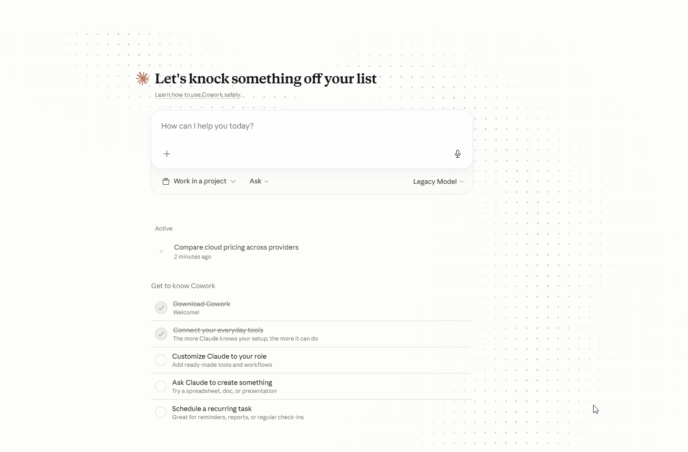

# cloudprice-mcp

<!-- mcp-name: io.github.Albaker-Group/cloudprice-mcp -->

[](https://pypi.org/project/cloudprice-mcp/)
[](https://pypi.org/project/cloudprice-mcp/)
[](LICENSE)
[](https://glama.ai/mcp/servers/Albaker-Group/cloudprice-mcp)

**Ask your AI assistant what the cloud will cost — and get real list prices back.**

cloudprice-mcp gives Claude, Cursor, GitHub Copilot and any other MCP client
pricing and FinOps tools across **AWS, Azure, GCP and OCI**, plus LLM token
prices for ~2,300 model/provider combinations. No cloud account, no API keys:
it works from a catalogue refreshed every week from the providers' public
pricing APIs.

- **Four clouds in one answer**, including OCI and its 10 TB free egress — which
  most tools leave out.
- **Cloud and AI costs side by side**: price a VM, a GPU and the LLM calls
  running on it in the same conversation.
- **Price history**: every weekly catalogue is archived, so you can ask what
  changed, not just what it costs today.
- **Decisions, not just lookups**: RI / Savings Plan break-even, 3-year TCO,
  migration payback, egress arbitrage, carbon (kg CO2e), FOCUS 1.3 export.



## Quick start

Add this to your MCP client's config (Claude Desktop, Cursor, VS Code, …).
[`uvx`](https://docs.astral.sh/uv/) downloads and runs it — nothing to install
first:

```json
{
  "mcpServers": {
    "cloudprice": { "command": "uvx", "args": ["cloudprice-mcp"] }
  }
}
```

Claude Code: `claude mcp add cloudprice -- uvx cloudprice-mcp`

Or install with pip and let it configure every client it finds (asks before
writing each one):

```bash
pip install cloudprice-mcp
cloudprice-mcp setup
```

Restart the client and the **28 tools** appear. Problems? `cloudprice-mcp doctor`
says what is wrong; [INSTALL.md](INSTALL.md) has per-client steps for Windows,
macOS and Linux. Python 3.10+.

## Things to ask

> *"I run 6× t3.2xlarge on AWS. On-demand vs 1-year Savings Plan vs 3-year RI —
> what's the break-even month?"* → `optimize_commitment`

> *"At 50 TB/month internet egress, which cloud is cheapest, and what would
> moving save over 3 years?"* → `compare_egress`, `find_egress_arbitrage`
> (OCI ≈ $340/mo vs ≈ $4,000/mo on the hyperscalers)

> *"Size this 3-tier app on all four clouds: 8 web (4 vCPU/16 GB), 12 app
> (8/32), 4 DB (16/64), 5 TB SSD, 10 TB/month egress, multi-AZ."* →
> `compare_workload`, `compare_total_cost_of_ownership`

> *"Cheapest way to run 50M input / 10M output tokens a month — and is Claude
> Sonnet the same price on Bedrock and Vertex?"* → `compare_token_pricing`

> *"Which H100 instance is cheapest per GPU-hour across the four clouds?"* →
> `compare_gpu_workload`

> *"We send 2B input / 500M output tokens a month to an API. Would renting
> 8×H100 and serving Llama ourselves be cheaper, and at what volume?"* →
> `compare_llm_vs_selfhost`

> *"My support agent averages 8 steps with a 2k system prompt and 3k of tool
> definitions. What does 50,000 runs a month cost on Sonnet vs Haiku, and how
> much does prompt caching save — and hosted on AgentCore or Lambda?"* →
> `estimate_agent_cost` (tokens + AgentCore Runtime/Gateway/Memory vs Lambda)

> *"What changed in LLM pricing this week — anything cheaper on Bedrock or
> Groq?"* → `llm_price_changes` (weekly archive of ~3,600 model/provider prices)

> *"How has OCI E5.Flex pricing moved since May?"* → `get_price_history`

Every answer carries the catalogue date and an `honest_gaps` list of what the
tool does not model, so the AI can tell you where the number stops being exact.

## Tools

**28 tools**, grouped by job. Full descriptions and arguments:
**[docs/TOOLS.md](docs/TOOLS.md)** (generated from the server, so it is always
current).

| Job | Tools |
|---|---|
| Look up one price | `get_aws_price`, `get_azure_price`, `get_gcp_price`, `compare_clouds` |
| Price a workload | `compare_compute_inventory`, `compare_storage_inventory`, `compare_workload`, `compare_object_storage`, `compare_postgres_database`, `compare_egress` |
| FinOps decisions | `assess_migration`, `optimize_commitment`, `compare_total_cost_of_ownership`, `find_egress_arbitrage`, `generate_decision_report` |
| Spot, GPU, carbon | `compare_spot`, `compare_gpu_workload`, `compare_carbon_footprint` |
| Price history | `get_price_history`, `list_tracked_skus`, `detect_price_anomalies`, `watch_workload` |
| AI / LLM costs | `estimate_agent_cost`, `compare_llm_vs_selfhost`, `compare_token_pricing`, `lookup_extended_model_pricing`, `llm_price_changes` |
| Export | `export_focus` |

### Example: `compare_workload` input

```json
{
  "compute": [
    { "name": "web", "vcpus": 4,  "memory_gb": 16, "quantity": 8,  "os_disk_gb": 100, "os_disk_type": "ssd" },
    { "name": "app", "vcpus": 8,  "memory_gb": 32, "quantity": 12, "os_disk_gb": 200, "os_disk_type": "ssd" },
    { "name": "db",  "vcpus": 16, "memory_gb": 64, "quantity": 4,  "os_disk_gb": 500, "os_disk_type": "ssd" }
  ],
  "storage": [
    { "name": "shared-fast", "capacity_gb": 5000,  "disk_type": "ssd" },
    { "name": "shared-bulk", "capacity_gb": 50000, "disk_type": "hdd" }
  ],
  "commitment": "1yr_no_upfront",
  "multi_az": true
}
```

**Modelling notes.** Commitments apply a conservative compute discount (1-year
≈ 30%, 3-year ≈ 50%); storage is not discounted. Snapshots are priced as full
copies by default — set `snapshot_incremental_factor` (e.g. `0.3`) for
real-world incremental snapshots. `multi_az` doubles compute, not storage.

## Pricing data

Prices are bundled as a curated dataset of common SKUs across **4 clouds**:
- **Compute** (~50 VM SKUs across AWS / Azure / GCP / OCI, including OCI A1 Always Free + A2 Arm Ampere + E5 Flex)
- **Block storage** (SSD + HDD per cloud)
- **Object storage** (Hot / Cool / Archive tiers per cloud, including OCI Always Free 20 GB)
- **Managed PostgreSQL** (RDS / Azure DB / Cloud SQL / OCI Database with PostgreSQL)

### Auto-refreshed weekly

The bundled catalog is refreshed every Sunday by a GitHub Action that hits each cloud's public pricing API:

- **AWS** — [Pricing API](https://docs.aws.amazon.com/awsaccountbilling/latest/aboutv2/price-changes.html) (via boto3, OIDC-authenticated)
- **Azure** — [Retail Prices API](https://learn.microsoft.com/en-us/rest/api/cost-management/retail-prices/azure-retail-prices) (public, no auth)
- **OCI** — [Public pricing API](https://apexapps.oracle.com/pls/apex/cetools/api/v1/products/) (public, no auth)
- **GCP** — [Cloud Billing Catalog API](https://cloud.google.com/billing/docs/reference/rest/v1/services.skus) (via API key — `GCP_API_KEY` env var). Added in v0.8.0
- **Bedrock LLM token prices** — [AWS Pricing API](https://docs.aws.amazon.com/awsaccountbilling/latest/aboutv2/billing-getting-started.html) `AmazonBedrock` service code (via boto3, same OIDC role). Added in v0.15.0 — refreshes input/output token rates for every Bedrock-hosted model we track (Claude 4 Opus/Sonnet, Claude 3/3.5 Haiku, Llama 3.1/3.3, Mistral Large 2, DeepSeek R1)
- **Extended LLM catalog** — [LiteLLM's `model_prices_and_context_window.json`](https://github.com/BerriAI/litellm/blob/main/model_prices_and_context_window.json) (MIT-licensed, community-maintained, unauthenticated). Added in v0.16.0 — ingests ~2000 (model, provider) combinations covering Together AI, Fireworks, Groq, Replicate, Perplexity, regional Bedrock/Azure variants, older model versions. Powers the `lookup_extended_model_pricing` tool. Curated hand-vetted prices (`compare_token_pricing`) and extended (`lookup_extended_model_pricing`) are deliberately separate so users always know which catalog they're hitting.

Each refresh writes a **dated snapshot** to `src/cloudprice_mcp/data/prices/YYYY-MM-DD.json` and `src/cloudprice_mcp/data/token_prices/YYYY-MM-DD.json` — every JSON ever published lives in the repo. The history archive is MIT-licensed and grows with every release.

Every tool result includes the catalog's `as_of` field so you know exactly which prices were used.

### Public price history dataset

cloudprice-mcp is the only FinOps tool we know of that **preserves every weekly snapshot**. You can query *"what did m5.xlarge cost in May?"* — neither AWS Calculator nor GCP Estimator can answer that because their pages always show today.

**Query the history from the CLI:**

```bash
cloudprice-mcp history --cloud oci --sku VM.Standard.E5.Flex.4OCPU
# oci/VM.Standard.E5.Flex.4OCPU (us-ashburn-1) — 2 data point(s)
#
# AS_OF          HOURLY USD
# --------------------------
# 2026-04-26   $    0.67600
# 2026-05-12   $    0.18400
#
# Change: -72.78% ($-0.49200/h)
```

The -72.78% drop is the v0.7.0 auto-refresh **fixing a hand-curated inaccuracy** in the prior OCI catalog — proof that the auto-refresh story works.

**Query the history from AI assistants** via two new MCP tools:

- `get_price_history(cloud, sku, since?)` — full timeseries + change stats
- `list_tracked_skus(cloud?, since?)` — every (cloud, sku) pair we have history for

Real questions this unlocks:

> *"Has AWS m5.xlarge changed price in the last quarter?"*
> → AI calls `get_price_history`, returns timeseries with start/end prices and % change.

> *"Show me every multi-cloud price mover since January."*
> → AI calls `list_tracked_skus(since="2026-01-01")`, returns every SKU + its latest price + change.

### Cross-provider LLM token pricing

Token costs are the fastest-growing FinOps line item in 2026 — and **nobody compares them cross-provider openly**. The same model is often available on multiple providers at different prices (Claude on Anthropic / Bedrock / Vertex; GPT on OpenAI / Azure OpenAI; Llama on Bedrock).

```python
from cloudprice_mcp.finops.tokens import compare_token_pricing

# Cheapest model overall for a 50M-in / 10M-out monthly workload
r = compare_token_pricing(
    monthly_input_tokens=50_000_000,
    monthly_output_tokens=10_000_000,
)
# gemini-1.5-flash on google is cheapest at $6.75/mo for 50M in / 10M out tokens.
#   gemini-1.5-flash       on google        $   6.75/mo
#   gemini-1.5-flash       on vertex        $   6.75/mo
#   gemini-2.0-flash       on google        $   9.00/mo
#   llama-3.1-8b           on bedrock       $  13.20/mo
#   gpt-4o-mini            on openai        $  13.50/mo
#   deepseek-v3            on deepseek      $  24.50/mo
```

```python
# Same model across all hosts — proves Claude 4 Sonnet provider parity
# (and surfaces that only Anthropic API publishes the 90%-off cache_read rate)
r = compare_token_pricing(model_id="claude-4-sonnet")
#   anthropic   in=$3/1M  out=$15/1M  cache_read=$0.30/1M  cache_write=$3.75/1M
#   bedrock     in=$3/1M  out=$15/1M
#   vertex      in=$3/1M  out=$15/1M
```

Covers 19 models across 8 providers: Claude (4 Opus / 4 Sonnet / 3.5 Haiku / 3 Haiku), GPT (5, 5 mini, 4o, 4o-mini, o1), Gemini (2.0 Flash, 1.5 Pro/Flash), Llama (3.1 8B/70B/405B, 3.3 70B), Mistral Large 2, DeepSeek V3/R1.

Real questions this unlocks:

> *"Cheapest model that handles 200K context for output-heavy chat at 10M/mo output volume?"*
> → AI calls `compare_token_pricing` with the volume + an optional model_family filter, returns ranked monthly cost across every viable model+provider combo.

> *"Should I use Anthropic API or Bedrock for Claude?"*
> → `compare_token_pricing(model_id="claude-4-sonnet")` shows price parity on per-token rates, but Anthropic API exposes a 10x cheaper cache_read rate that Bedrock doesn't publish. For caching-heavy workloads, Anthropic wins.

### Multi-cloud GPU pricing

The fastest-growing cloud cost category — and nobody compares it cross-cloud openly.

```python
from cloudprice_mcp.finops.gpu import compare_gpu_workload
from cloudprice_mcp.pricing import load_catalog

r = compare_gpu_workload(load_catalog(), gpu_type="H100", gpu_count=8)
# OCI BM.GPU.H100.8 is cheapest at $80.0000/h for 8x H100.
#   oci    BM.GPU.H100.8                  $ 80.0000/h  $10.0000/GPU/h
#   gcp    a3-highgpu-8g                  $ 84.4000/h  $10.5500/GPU/h
#   aws    p5.48xlarge                    $ 98.3200/h  $12.2900/GPU/h
#   azure  ND96isr_H100_v5                $ 98.3200/h  $12.2900/GPU/h
```

Covers NVIDIA T4, A10, A10G, L4, L40S, V100, A100, H100 across all 4 clouds. Returns:

- **Absolute hourly winner** — the cheapest matching SKU per cloud
- **Per-GPU efficiency winner** — sometimes a different cloud (e.g., OCI's BM.GPU4.8 is cheapest *per GPU* but only sold as 8x, so for `gpu_count=1` Azure/GCP win the absolute ranking)
- **Over-provisioning flags** — when the only matching SKU bundles more GPUs than asked for
- **GPU memory** — differentiates A100 40GB vs 80GB (same `gpu_type` field)

The OCI H100 finding is real: at 8x H100 it's ~19% cheaper than AWS/Azure for identical hardware.

### Cost Drift Sentinel

The shift from query tool to **agent capability**. Most FinOps tools answer *"what does this cost?"* — this one answers *"is this still what it cost when I signed off on it?"*

```python
from cloudprice_mcp.finops.sentinel import watch_workload
from cloudprice_mcp.inventory import parse_dict
from cloudprice_mcp.pricing import load_catalog

# First call — captures a baseline. Persist the returned baseline JSON.
result = watch_workload(load_catalog(), parse_dict(workload_spec))
save(result["baseline"])

# Later — pass the baseline back to detect drift.
report = watch_workload(load_catalog(), parse_dict(workload_spec), baseline=load_baseline())
if report["alert_triggered"]:
    notify_humans(report["headline"])
```

**Stateless by design** — no server, no database. The baseline JSON lives wherever you want: a file in your IaC repo, S3, Slack DM, anywhere. Each call is a pure function of `(catalog, workload, baseline)`.

Key properties:
- **Workload-hash protected** — if you change the workload spec, the hash mismatches and you get a fresh baseline rather than a misleading drift report
- **SKU-level attribution** — the drift report consults the price-history dataset and surfaces which SKUs moved the most between baseline and now
- **Configurable threshold** — default 5%; pass `alert_threshold_pct=N` to tune

**Plug-and-play GitHub Action template** at [`examples/cloudprice-watch.yml`](examples/cloudprice-watch.yml) — drop it in any IaC repo with a `workload.json`, get auto-opened GitHub issues when costs drift. Baseline is committed to your repo so the history is auditable.

### Carbon-aware FinOps — kg CO2e per workload, alongside USD

The only FinOps MCP tool that returns **both cost AND carbon footprint** on the same query. AWS / Azure / GCP each publish their own customer dashboards (Customer Carbon Footprint Tool, Emissions Impact Dashboard, Carbon Footprint) — but none compare across providers. cloudprice does.

```python
from cloudprice_mcp.finops.carbon import compare_carbon_footprint
from cloudprice_mcp.pricing import load_catalog

result = compare_carbon_footprint(load_catalog(), vcpus=8, memory_gb=32, quantity=6)
# Returns per-cloud SKU + cost + power class (x86/ARM) + monthly kWh +
# grid-based kg CO2e + market-based residual kg CO2e (after renewable matching),
# ranked cheapest-carbon-first.
```

What's modeled (and disclosed in every response):
- **PUE per cloud** from each provider's public sustainability report
- **Grid carbon intensity per region** from public emissions data (EPA eGRID for US, similar baselines elsewhere)
- **Renewable matching** per provider (AWS/Azure 100%, GCP ~64% CFE, OCI unmatched outside EU)
- **ARM vs x86 power class** — ARM SKUs (Graviton, Ampere, Axion) modeled at ~30% lower per-vCPU power
- **Two carbon numbers per cloud**: location-based (grid) AND market-based (residual after renewable matching) — both surfaced so auditors can see both perspectives

What's NOT modeled (always disclosed via `honest_gaps[]`):
- Embodied carbon (server manufacturing) — operational only
- GPU / network / storage power — compute + memory only
- Time-of-use grid variation — annual averages only
- Real-time 24/7 CFE matching — GCP publishes annual CFE %; cloudprice uses that

Real questions this unlocks:

> *"What's the lowest-carbon cloud for 4 vCPU / 16 GB at 6 instances?"*
> → AI calls `compare_carbon_footprint`, returns per-cloud kg CO2e/mo ranked.

> *"How much carbon do I save running on ARM vs x86?"*
> → AI calls it twice with the same shape but different target SKUs.

### What's NOT modeled (real-world TCO killers)
- ✅ ~~Egress / data transfer~~ — **modeled in v0.5** (`compare_egress`)
- ✅ ~~Multi-AZ / HA replicas~~ — **modeled in v0.5** (`multi_az: true` on `compare_workload`)
- ✅ ~~Snapshots upper-bound only~~ — **fixed in v0.5** (`snapshot_incremental_factor`)
- **Reserved/Savings Plan SKU detail** (we apply a flat tier discount, not per-region/per-family detail) — roadmap
- **Multi-region pricing** (currently us-east only; us-west / eu-west planned for v0.5.1) — roadmap
- **IOPS-based storage matching** (capacity-only) — roadmap
- **Backup storage charges** (some clouds free, others billed) — roadmap
- **Request costs** (PUT/GET pricing for object storage) — roadmap
- **Retrieval costs** for archive tiers (Glacier-style retrieval can be 10× the storage cost) — roadmap
- **VPC peering / interconnect costs** — roadmap

These are tracked roadmap items. **Use cloudprice-mcp for the on-demand list-price baseline; do final TCO analysis with each cloud's own calculator before relying on numbers for big decisions.**

**Live runtime pricing (not just weekly refresh)** is being considered for v0.8 — would fetch prices directly at MCP tool invocation time instead of from the bundled catalog. Trade-offs: slower (network call per tool use), adds GCP auth requirement, breaks offline mode. The v0.7 weekly auto-refresh covers ~95% of the credibility win at zero runtime cost; live mode is opt-in territory.

## Develop locally

```bash
git clone https://github.com/Albaker-Group/cloudprice-mcp.git
cd cloudprice-mcp
uv sync                     # Python + dev tools at the versions in uv.lock (see mise.toml)
uv run pytest               # CI also runs: ruff check, ruff format --check, coverage floor
uv run python scripts/gen_tools_md.py   # after changing a tool's description
```

To point Claude Desktop at your dev copy, swap the `command` in the config:

```json
{
  "mcpServers": {
    "cloudprice": {
      "command": "python",
      "args": ["-m", "cloudprice_mcp.server"]
    }
  }
}
```

## License

MIT — see [LICENSE](LICENSE).

## Credits

Built by [Ali Albaker](https://cloud.albaker.info), multi-cloud architect — runs a live three-cloud portfolio at ~$1.80/month across AWS, Azure, and GCP, with OCI joining as the 4th cloud in 2026.
